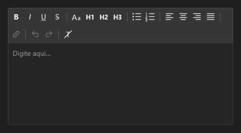

# RichEditor



O editor de texto rico (`QEditor`): o texto com formato e, em cima, a barra de ferramentas.

**Paleta:** Quasar · **controle visual** · também tem as [propriedades e eventos comuns a todo controle](controles.md)

## Propriedades

### Aparência

| Propriedade | No Object Inspector | Tipo | O que faz |
|---|---|---|---|
| `toolbar` | Barra de ferramentas | texto |  |
| `placeholder` | Texto de exemplo | texto |  |

### Comportamento

| Propriedade | No Object Inspector | Tipo | O que faz |
|---|---|---|---|
| `read_only` | Somente leitura | lógico |  |

### Dados

| Propriedade | No Object Inspector | Tipo | O que faz |
|---|---|---|---|
| `html` | Conteúdo (HTML) | texto |  |

## Eventos

| Evento | Quando | No Object Inspector | Pergunta |
|---|---|---|---|
| `on_change` | o valor mudou (pelo usuário ou pelo código, como na VCL) | — |  |

## Em código

No form, o `RichEditor1` com o evento ligado (no Object Inspector, na aba Eventos):

```json
{ "class": "RichEditor", "name": "RichEditor1", "on_change": "rich_editor1_change" }
```

E o handler, um método do form (`self.RichEditor1` já é um `RichEditor`):

```rust
impl FrmPrincipal {
    pub fn rich_editor1_change(&mut self, ui: &mut Ui, _sender: ComponentId, _args: &EventArgs) {
        let atual = self.RichEditor1.html(ui);
        self.RichEditor1.set_html(ui, format!("{atual}!"));
    }
}
```
