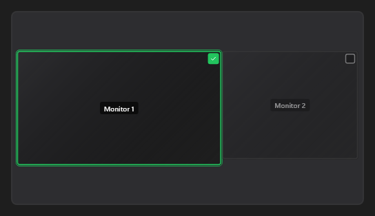

# ScreenLayout



As telas na posição real (como o "Configurações de vídeo" do sistema), escaladas para caber na caixa, cada uma com a prévia e a marca no canto: o clique marca ou desmarca e dispara `on_change` com o `id` da tela (`ScreenLayout::is_enabled` diz o novo estado). `locked` não deixa mudar (durante a gravação). As telas vêm do código (`ScreenLayout::set_screens`); as prévias, com `ScreenLayout::set_image`.

**Paleta:** Media · **controle visual** · também tem as [propriedades e eventos comuns a todo controle](controles.md)

## Propriedades

### Comportamento

| Propriedade | No Object Inspector | Tipo | O que faz |
|---|---|---|---|
| `locked` | Travado | lógico |  |

## Eventos

| Evento | Quando | No Object Inspector | Pergunta |
|---|---|---|---|
| `on_change` | o valor mudou (pelo usuário ou pelo código, como na VCL) | — |  |

## Em código

No form, o `ScreenLayout1` com o evento ligado (no Object Inspector, na aba Eventos):

```json
{ "class": "ScreenLayout", "name": "ScreenLayout1", "on_change": "screen_layout1_change" }
```

E o handler, um método do form (`self.ScreenLayout1` já é um `ScreenLayout`):

```rust
impl FrmPrincipal {
    pub fn screen_layout1_change(&mut self, ui: &mut Ui, _sender: ComponentId, _args: &EventArgs) {
        let atual = self.ScreenLayout1.locked(ui);
        self.ScreenLayout1.set_locked(ui, !atual);
    }
}
```
