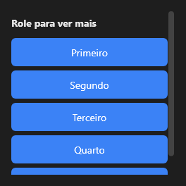

# ScrollBox



Área com rolagem vertical. Os filhos usam o layout normal (por exemplo `align: top`, empilhados); o que passar da altura rola com a roda do mouse ou arrastando a barra. `on_scroll` avisa quando o usuário rola (roda, dedo, barra), com a posição nova; o que o código posiciona não avisa. `scroll_position` lê e grava a posição, `scroll_to(componente)` rola o mínimo para ele ficar inteiro à vista e `visible_components(lista, inteiros)` diz quais filhos da lista estão à vista (os caminhos, separados por `;`; em Rust, `ScrollBox::visible_children`).

**Paleta:** Layouts · **controle visual** · também tem as [propriedades e eventos comuns a todo controle](controles.md)

## Propriedades

### Aparência

| Propriedade | No Object Inspector | Tipo | O que faz |
|---|---|---|---|
| `gutter` | Reservar a calha da barra | lógico | A calha da barra: `true` (o padrão) reserva o lugar dela sempre (o `scrollbar-gutter: stable`); `false`, a barra passa por cima do conteúdo, que usa a largura toda (L01 do Tabernáculo). |

### Comportamento

| Propriedade | No Object Inspector | Tipo | O que faz |
|---|---|---|---|
| `overscroll` | Fim da rolagem | um de: `auto`, `glow`, `stretch`, `bounce`, `none` | O efeito de fim da rolagem no toque (`auto`: o do sistema; veja `aylis_core::overscroll`). |
| `horizontal` | Horizontal | lógico | Rola para os lados em vez de para baixo (filhos com `align: left`, lado a lado). |
| `pull_to_refresh` | Puxar para atualizar | lógico | Puxar para baixo no topo atualiza (o `v-pull-to-refresh`): dispara `on_refresh` e mostra o indicador enquanto `refreshing` estiver ligado (quem atualiza desliga). |
| `refreshing` | Atualizando | lógico | Mostra o indicador de atualização no topo; quem atualiza desliga ao terminar. |
| `wheel_step` | Passo da roda | número | Pontos por dente da roda (0 = o do app, `Ui::scroll_options`(aylis_core::Ui::scroll_options)). |
| `smooth` | Rolagem suave | um de: `default`, `on`, `off` | Deslizar na roda: `default` (o do app), `on` ou `off`. |

### Teclado

| Propriedade | No Object Inspector | Tipo | O que faz |
|---|---|---|---|
| `allowed_chars` | Caracteres permitidos | texto | Os caracteres dos campos dentro da caixa (veja o `Form`). |
| `blocked_chars` | Caracteres bloqueados | texto | Os caracteres que os campos de dentro não aceitam (digitados ou colados); faixas como `a-z`. Vazio: nenhum. |
| `only_allowed` | Só os permitidos | lógico | Só os caracteres de `allowed_chars` entram nos campos de dentro. |
| `chars_override` | Força os caracteres | lógico | O filtro de caracteres da caixa manda nos campos de dentro (sem ele, o do campo decide primeiro). |
| `char_map` | Trocas de caracteres | texto | Trocas do que o teclado produz nos campos de dentro (`",."`: vírgula por ponto), com a mesma herança dos filtros. |

## Eventos

| Evento | Quando | No Object Inspector | Pergunta |
|---|---|---|---|
| `on_end_reached` | — | — |  |
| `on_refresh` | — | — |  |
| `on_scroll` | — | — |  |

## Em código

No form, o `ScrollBox1` com o evento ligado (no Object Inspector, na aba Eventos):

```json
{ "class": "ScrollBox", "name": "ScrollBox1", "on_end_reached": "scroll_box1_end_reached" }
```

E o handler, um método do form (`self.ScrollBox1` já é um `ScrollBox`):

```rust
impl FrmPrincipal {
    pub fn scroll_box1_end_reached(&mut self, ui: &mut Ui, _sender: ComponentId, _args: &EventArgs) {
        let atual = self.ScrollBox1.horizontal(ui);
        self.ScrollBox1.set_horizontal(ui, !atual);
    }
}
```
