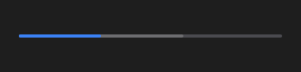

# SeekBar



Barra de reprodução de mídia: posição, trecho já carregado (`buffered`), marcas (`markers`, em segundos: "12.5;30") e, sob o mouse, o horário naquele ponto. Arrastar dispara `on_change` (posição nova, a cada movimento) e soltar `on_seek`.

**Paleta:** Media · **controle visual** · também tem as [propriedades e eventos comuns a todo controle](controles.md)

## Propriedades

### Aparência

| Propriedade | No Object Inspector | Tipo | O que faz |
|---|---|---|---|
| `show_time` | Mostra o tempo | lógico | Mostra, sob o mouse, o horário daquele ponto. |

### Dados

| Propriedade | No Object Inspector | Tipo | O que faz |
|---|---|---|---|
| `position` | Posição | número | Em segundos. |
| `duration` | Duração | número | A duração da mídia, em segundos: o fim da barra. |
| `buffered` | Carregado | número | Até onde a mídia já carregou, em segundos (o trecho mais claro); 0: nada. |
| `markers` | Marcadores | texto | Marcas na barra, em segundos, separadas por `;` (`12.5;30`); vazio: nenhuma. |

## Eventos

| Evento | Quando | No Object Inspector | Pergunta |
|---|---|---|---|
| `on_change` | o valor mudou (pelo usuário ou pelo código) | — |  |
| `on_seek` | — | — |  |

## Em código

No form, o `SeekBar1` com o evento ligado (no Object Inspector, na aba Eventos):

```json
{ "class": "SeekBar", "name": "SeekBar1", "on_change": "seek_bar1_change" }
```

E o handler, um método do form (`self.SeekBar1` já é um `SeekBar`):

```rust
impl FrmPrincipal {
    pub fn seek_bar1_change(&mut self, ui: &mut Ui, _sender: ComponentId, _args: &EventArgs) {
        let atual = self.SeekBar1.position(ui);
        self.SeekBar1.set_position(ui, atual + 10.0);
    }
}
```
