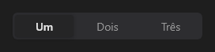

# SegmentedControl



Seletor segmentado: opções lado a lado, uma escolhida (abas de modo, filtro de vista). `items` = "Tela;Janela;Área", `icons` opcionais na mesma ordem. A marcação desliza até a opção escolhida. Setas trocam a opção com o foco.

**Paleta:** Standard · **controle visual** · também tem as [propriedades e eventos comuns a todo controle](controles.md)

## Propriedades

### Aparência

| Propriedade | No Object Inspector | Tipo |
|---|---|---|
| `icons` | Ícones | texto |

### Dados

| Propriedade | No Object Inspector | Tipo |
|---|---|---|
| `items` | Itens | texto |
| `item_index` | Item escolhido | inteiro |

## Eventos

| Evento | Quando | No Object Inspector | Pergunta |
|---|---|---|---|
| `on_change` | o valor mudou (pelo usuário ou pelo código, como na VCL) | — |  |

## Em código

No form, o `SegmentedControl1` com o evento ligado (no Object Inspector, na aba Eventos):

```json
{ "class": "SegmentedControl", "name": "SegmentedControl1", "on_change": "segmented_control1_change" }
```

E o handler, um método do form (`self.SegmentedControl1` já é um `SegmentedControl`):

```rust
impl FrmPrincipal {
    pub fn segmented_control1_change(&mut self, ui: &mut Ui, _sender: ComponentId, _args: &EventArgs) {
        let atual = self.SegmentedControl1.items(ui);
        self.SegmentedControl1.set_items(ui, format!("{atual}!"));
    }
}
```
