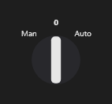

# SelectorSwitch



Chave seletora (`Man;0;Auto`): a manopla aponta para a posição escolhida; o clique passa para a próxima (com `on_change`).

**Paleta:** Industrial · **controle visual** · também tem as [propriedades e eventos comuns a todo controle](controles.md)

## Propriedades

### Dados

| Propriedade | No Object Inspector | Tipo |
|---|---|---|
| `positions` | Posições | texto |
| `item_index` | Item escolhido | inteiro |

## Eventos

| Evento | Quando | No Object Inspector | Pergunta |
|---|---|---|---|
| `on_change` | o valor mudou (pelo usuário ou pelo código, como na VCL) | — |  |

## Em código

No form, o `SelectorSwitch1` com o evento ligado (no Object Inspector, na aba Eventos):

```json
{ "class": "SelectorSwitch", "name": "SelectorSwitch1", "on_change": "selector_switch1_change" }
```

E o handler, um método do form (`self.SelectorSwitch1` já é um `SelectorSwitch`):

```rust
impl FrmPrincipal {
    pub fn selector_switch1_change(&mut self, ui: &mut Ui, _sender: ComponentId, _args: &EventArgs) {
        let atual = self.SelectorSwitch1.positions(ui);
        self.SelectorSwitch1.set_positions(ui, format!("{atual}!"));
    }
}
```
