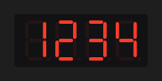

# SevenSegment



Mostrador de 7 segmentos (números, `-`, `.` e algumas letras).

**Paleta:** Industrial · **controle visual** · também tem as [propriedades e eventos comuns a todo controle](controles.md)

## Propriedades

### Aparência

| Propriedade | No Object Inspector | Tipo | O que faz |
|---|---|---|---|
| `digits` | Só números | inteiro | Quantos dígitos (alinha à direita, como num painel). |
| `color` | Cor | cor | A cor dos segmentos acesos. |

### Dados

| Propriedade | No Object Inspector | Tipo | O que faz |
|---|---|---|---|
| `text` | Texto | texto | O que aparece nos dígitos (números, `-`, `.` e algumas letras; o resto fica apagado). |

## Em código

No form, o `SevenSegment1` com o evento ligado (no Object Inspector, na aba Eventos):

```json
{ "class": "SevenSegment", "name": "SevenSegment1" }
```

E o handler, um método do form (`self.SevenSegment1` já é um `SevenSegment`):

```rust
impl FrmPrincipal {
    pub fn form_show(&mut self, ui: &mut Ui, _sender: ComponentId, _args: &EventArgs) {
        let atual = self.SevenSegment1.text(ui);
        self.SevenSegment1.set_text(ui, format!("{atual}!"));
    }
}
```

(Sem eventos próprios: o exemplo usa o `on_show` do form.)
