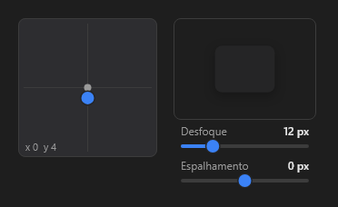

# ShadowEditor



Editor de sombra (o do DevTools para `box-shadow`): o quadro arrasta o deslocamento (Shift trava num eixo), as faixas ajustam desfoque e espalhamento e a amostra mostra o resultado. A cor vem de `color` (a IDE abre o seletor de cores ao lado).

**Paleta:** Additional · **controle visual** · também tem as [propriedades e eventos comuns a todo controle](controles.md)

## Propriedades

### Comportamento

| Propriedade | No Object Inspector | Tipo |
|---|---|---|
| `range` | Intervalo de datas | número |

### Dados

| Propriedade | No Object Inspector | Tipo |
|---|---|---|
| `offset_x` | Deslocamento X | número |
| `offset_y` | Deslocamento Y | número |
| `blur` | Desfoque | número |
| `spread` | Expansão | número |
| `color` | Cor | cor |

## Eventos

| Evento | Quando | No Object Inspector | Pergunta |
|---|---|---|---|
| `on_change` | o valor mudou (pelo usuário ou pelo código, como na VCL) | — |  |
| `on_commit` | — | — |  |

## Em código

No form, o `ShadowEditor1` com o evento ligado (no Object Inspector, na aba Eventos):

```json
{ "class": "ShadowEditor", "name": "ShadowEditor1", "on_change": "shadow_editor1_change" }
```

E o handler, um método do form (`self.ShadowEditor1` já é um `ShadowEditor`):

```rust
impl FrmPrincipal {
    pub fn shadow_editor1_change(&mut self, ui: &mut Ui, _sender: ComponentId, _args: &EventArgs) {
        let atual = self.ShadowEditor1.offset_x(ui);
        self.ShadowEditor1.set_offset_x(ui, atual + 10.0);
    }
}
```
