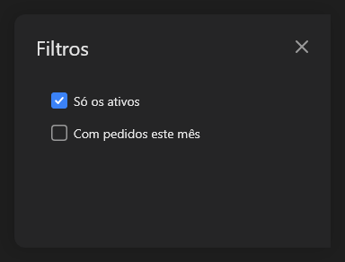

# SideSheet



Folha lateral (o "side sheet" do Material 3): um contêiner à direita com título e botão de fechar (`on_close`, que também desliga `open`). Coloque os controles dentro.

**Paleta:** Layouts · **controle visual** · também tem as [propriedades e eventos comuns a todo controle](controles.md)

## Propriedades

### Aparência

| Propriedade | No Object Inspector | Tipo |
|---|---|---|
| `title` | Título | texto |

### Comportamento

| Propriedade | No Object Inspector | Tipo |
|---|---|---|
| `open` | Aberto | lógico |

### Posição e tamanho

| Propriedade | No Object Inspector | Tipo |
|---|---|---|
| `sheet_width` | Largura da folha | número |

## Eventos

| Evento | Quando | No Object Inspector | Pergunta |
|---|---|---|---|
| `on_close` | o form fechou | — |  |

## Em código

No form, o `SideSheet1` com o evento ligado (no Object Inspector, na aba Eventos):

```json
{ "class": "SideSheet", "name": "SideSheet1", "on_close": "side_sheet1_close" }
```

E o handler, um método do form (`self.SideSheet1` já é um `SideSheet`):

```rust
impl FrmPrincipal {
    pub fn side_sheet1_close(&mut self, ui: &mut Ui, _sender: ComponentId, _args: &EventArgs) {
        let atual = self.SideSheet1.title(ui);
        self.SideSheet1.set_title(ui, format!("{atual}!"));
    }
}
```
