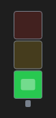

# SignalLight



Sinaleiro (torre de luz): vermelho, amarelo e verde empilhados; `state` acende um (ou `lights`: vários, `red;green`), `blink` pisca.

**Paleta:** Industrial · **controle visual** · também tem as [propriedades e eventos comuns a todo controle](controles.md)

## Propriedades

### Dados

| Propriedade | No Object Inspector | Tipo |
|---|---|---|
| `state` | Estado | um de: `off`, `green`, `yellow`, `red`, `blue`, `white` |
| `lights` | Luzes | texto |
| `blink` | Piscar | lógico |

## Em código

No form, o `SignalLight1` com o evento ligado (no Object Inspector, na aba Eventos):

```json
{ "class": "SignalLight", "name": "SignalLight1" }
```

E o handler, um método do form (`self.SignalLight1` já é um `SignalLight`):

```rust
impl FrmPrincipal {
    pub fn form_show(&mut self, ui: &mut Ui, _sender: ComponentId, _args: &EventArgs) {
        let atual = self.SignalLight1.lights(ui);
        self.SignalLight1.set_lights(ui, format!("{atual}!"));
    }
}
```

(Sem eventos próprios: o exemplo usa o `on_show` do form.)
