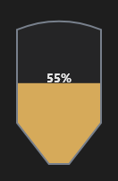

# Silo



Silo: o corpo com o funil embaixo e o nível do material (`value`, %).

**Paleta:** Industrial · **controle visual** · também tem as [propriedades e eventos comuns a todo controle](controles.md)

## Propriedades

### Aparência

| Propriedade | No Object Inspector | Tipo |
|---|---|---|
| `material` | Material | cor |

### Dados

| Propriedade | No Object Inspector | Tipo |
|---|---|---|
| `value` | Valor | número |
| `alarm` | Alarme | lógico |

## Em código

No form, o `Silo1` com o evento ligado (no Object Inspector, na aba Eventos):

```json
{ "class": "Silo", "name": "Silo1" }
```

E o handler, um método do form (`self.Silo1` já é um `Silo`):

```rust
impl FrmPrincipal {
    pub fn form_show(&mut self, ui: &mut Ui, _sender: ComponentId, _args: &EventArgs) {
        let atual = self.Silo1.value(ui);
        self.Silo1.set_value(ui, atual + 10.0);
    }
}
```

(Sem eventos próprios: o exemplo usa o `on_show` do form.)
