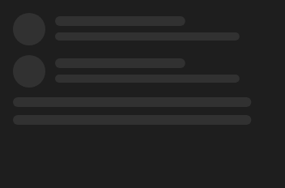

# SkeletonLoader



Esqueleto do conteúdo enquanto carrega (o `v-skeleton-loader`), com brilho passando. `layout` lista as peças separadas por vírgula: `avatar`, `heading`, `text`, `text@3` (três linhas), `image`, `button`, `chip`, `list-item` (avatar e duas linhas), `card` (imagem, título e texto), `table-row`.

**Paleta:** Additional · **controle visual** · também tem as [propriedades e eventos comuns a todo controle](controles.md)

## Propriedades

### Aparência

| Propriedade | No Object Inspector | Tipo |
|---|---|---|
| `layout` | Disposição | texto |
| `animated` | Animado | lógico |

## Em código

No form, o `SkeletonLoader1` com o evento ligado (no Object Inspector, na aba Eventos):

```json
{ "class": "SkeletonLoader", "name": "SkeletonLoader1" }
```

E o handler, um método do form (`self.SkeletonLoader1` já é um `SkeletonLoader`):

```rust
impl FrmPrincipal {
    pub fn form_show(&mut self, ui: &mut Ui, _sender: ComponentId, _args: &EventArgs) {
        let atual = self.SkeletonLoader1.layout(ui);
        self.SkeletonLoader1.set_layout(ui, format!("{atual}!"));
    }
}
```

(Sem eventos próprios: o exemplo usa o `on_show` do form.)
