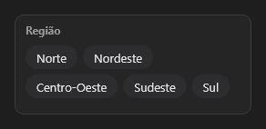

# Slicer



Segmentador de filtro (o "slicer" dos painéis): os valores como botões; marcar filtra. `selected` = `"Sul;Sudeste"` (vazio: todos). `on_change` traz a seleção.

**Paleta:** BI · **controle visual** · também tem as [propriedades e eventos comuns a todo controle](controles.md)

## Propriedades

### Aparência

| Propriedade | No Object Inspector | Tipo | O que faz |
|---|---|---|---|
| `title` | Título | texto | O título, no topo. |

### Comportamento

| Propriedade | No Object Inspector | Tipo | O que faz |
|---|---|---|---|
| `multi` | Várias escolhas | lógico | Deixa marcar vários valores; desligado, marcar um desmarca o outro. |

### Dados

| Propriedade | No Object Inspector | Tipo | O que faz |
|---|---|---|---|
| `items` | Itens | texto | Os valores que viram botões, separados por `;`. |
| `selected` | Escolhidos | texto | Os valores marcados, separados por `;`; vazio: todos (sem filtro). |

## Eventos

| Evento | Quando | No Object Inspector | Pergunta |
|---|---|---|---|
| `on_change` | o valor mudou (pelo usuário ou pelo código) | — |  |

## Em código

No form, o `Slicer1` com o evento ligado (no Object Inspector, na aba Eventos):

```json
{ "class": "Slicer", "name": "Slicer1", "on_change": "slicer1_change" }
```

E o handler, um método do form (`self.Slicer1` já é um `Slicer`):

```rust
impl FrmPrincipal {
    pub fn slicer1_change(&mut self, ui: &mut Ui, _sender: ComponentId, _args: &EventArgs) {
        let atual = self.Slicer1.title(ui);
        self.Slicer1.set_title(ui, format!("{atual}!"));
    }
}
```
