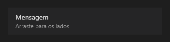

# SlideItem



O item que desliza (`QSlideItem`): uma linha de lista (`text`, `detail`, `icon`) que se arrasta para os lados e mostra a ação de baixo (`left_text`/`left_icon` na cor `left_color`, ao puxar para a direita; `right_*` ao puxar para a esquerda). Soltando depois de um terço, dispara `on_left` ou `on_right` e volta.

**Paleta:** Quasar · **controle visual** · também tem as [propriedades e eventos comuns a todo controle](controles.md)

## Propriedades

### Aparência

| Propriedade | No Object Inspector | Tipo | O que faz |
|---|---|---|---|
| `text` | Texto | texto |  |
| `detail` | Detalhe | texto |  |
| `icon` | Ícone | texto |  |
| `left_text` | Texto da esquerda | texto |  |
| `left_icon` | Ícone da esquerda | texto |  |
| `left_color` | Cor da esquerda | cor |  |
| `right_text` | Texto da direita | texto |  |
| `right_icon` | Ícone da direita | texto |  |
| `right_color` | Cor da direita | cor |  |

## Eventos

| Evento | Quando | No Object Inspector | Pergunta |
|---|---|---|---|
| `on_left` | — | — |  |
| `on_right` | — | — |  |

## Em código

No form, o `SlideItem1` com o evento ligado (no Object Inspector, na aba Eventos):

```json
{ "class": "SlideItem", "name": "SlideItem1", "on_left": "slide_item1_left" }
```

E o handler, um método do form (`self.SlideItem1` já é um `SlideItem`):

```rust
impl FrmPrincipal {
    pub fn slide_item1_left(&mut self, ui: &mut Ui, _sender: ComponentId, _args: &EventArgs) {
        let atual = self.SlideItem1.text(ui);
        self.SlideItem1.set_text(ui, format!("{atual}!"));
    }
}
```
