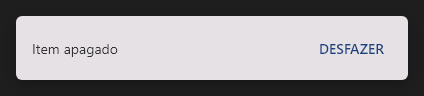

# Snackbar



Aviso no rodapé com uma ação opcional (o `v-snackbar`): "Item apagado · DESFAZER". Aparece com `active` (ou `Snackbar::show`) e some sozinho depois de `timeout` ms (0 = fica). `on_action` no clique da ação; `on_close` quando cada mensagem some.

**Paleta:** Additional · **controle visual** · também tem as [propriedades e eventos comuns a todo controle](controles.md)

## Propriedades

### Aparência

| Propriedade | No Object Inspector | Tipo |
|---|---|---|
| `text` | Texto | texto |
| `action` | Ação | texto |

### Comportamento

| Propriedade | No Object Inspector | Tipo |
|---|---|---|
| `timeout` | Tempo para sumir | duração (ms) |
| `active` | Ativo | lógico |

## Eventos

| Evento | Quando | No Object Inspector | Pergunta |
|---|---|---|---|
| `on_action` | — | — |  |
| `on_close` | o form fechou | — |  |

## Em código

No form, o `Snackbar1` com o evento ligado (no Object Inspector, na aba Eventos):

```json
{ "class": "Snackbar", "name": "Snackbar1", "on_action": "snackbar1_action" }
```

E o handler, um método do form (`self.Snackbar1` já é um `Snackbar`):

```rust
impl FrmPrincipal {
    pub fn snackbar1_action(&mut self, ui: &mut Ui, _sender: ComponentId, _args: &EventArgs) {
        let atual = self.Snackbar1.text(ui);
        self.Snackbar1.set_text(ui, format!("{atual}!"));
    }
}
```
