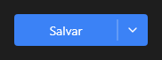

# SplitButton



Botão com ação principal e uma seta para mais opções (o `v-split-btn`): o clique no texto dispara `on_click`; na seta, abre o `popup_menu` (se houver) e dispara `on_dropdown`.

**Paleta:** Standard · **controle visual** · também tem as [propriedades e eventos comuns a todo controle](controles.md)

## Propriedades

### Aparência

| Propriedade | No Object Inspector | Tipo | O que faz |
|---|---|---|---|
| `text` | Texto | texto | O texto da ação principal. |
| `icon` | Ícone | texto | Ícone pelo nome, antes do texto; vazio: sem ícone. |

## Eventos

| Evento | Quando | No Object Inspector | Pergunta |
|---|---|---|---|
| `on_dropdown` | — | — |  |

## Em código

No form, o `SplitButton1` com o evento ligado (no Object Inspector, na aba Eventos):

```json
{ "class": "SplitButton", "name": "SplitButton1", "on_dropdown": "split_button1_dropdown" }
```

E o handler, um método do form (`self.SplitButton1` já é um `SplitButton`):

```rust
impl FrmPrincipal {
    pub fn split_button1_dropdown(&mut self, ui: &mut Ui, _sender: ComponentId, _args: &EventArgs) {
        let atual = self.SplitButton1.text(ui);
        self.SplitButton1.set_text(ui, format!("{atual}!"));
    }
}
```
