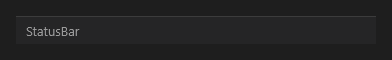

# StatusBar



Barra de status no rodapé: `text` à esquerda; aceita controles dentro (labels alinhados à direita, por exemplo).

**Paleta:** Layouts · **controle visual** · também tem as [propriedades e eventos comuns a todo controle](controles.md)

## Propriedades

### Aparência

| Propriedade | No Object Inspector | Tipo |
|---|---|---|
| `text` | Texto | texto |

## Em código

No form, o `StatusBar1` com o evento ligado (no Object Inspector, na aba Eventos):

```json
{ "class": "StatusBar", "name": "StatusBar1" }
```

E o handler, um método do form (`self.StatusBar1` já é um `StatusBar`):

```rust
impl FrmPrincipal {
    pub fn form_show(&mut self, ui: &mut Ui, _sender: ComponentId, _args: &EventArgs) {
        let atual = self.StatusBar1.text(ui);
        self.StatusBar1.set_text(ui, format!("{atual}!"));
    }
}
```

(Sem eventos próprios: o exemplo usa o `on_show` do form.)
