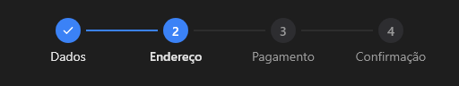

# Stepper



Etapas de um processo (o `v-stepper`): `items` com os nomes, `step` a atual (0 é a primeira); as anteriores ficam com ✓. Horizontal ou `vertical`. Clicar numa etapa já feita volta para ela (`on_change`).

**Paleta:** Additional · **controle visual** · também tem as [propriedades e eventos comuns a todo controle](controles.md)

## Propriedades

### Aparência

| Propriedade | No Object Inspector | Tipo |
|---|---|---|
| `vertical` | Vertical | lógico |

### Dados

| Propriedade | No Object Inspector | Tipo |
|---|---|---|
| `items` | Itens | texto |
| `step` | Passo | inteiro |

## Eventos

| Evento | Quando | No Object Inspector | Pergunta |
|---|---|---|---|
| `on_change` | o valor mudou (pelo usuário ou pelo código, como na VCL) | — |  |

## Em código

No form, o `Stepper1` com o evento ligado (no Object Inspector, na aba Eventos):

```json
{ "class": "Stepper", "name": "Stepper1", "on_change": "stepper1_change" }
```

E o handler, um método do form (`self.Stepper1` já é um `Stepper`):

```rust
impl FrmPrincipal {
    pub fn stepper1_change(&mut self, ui: &mut Ui, _sender: ComponentId, _args: &EventArgs) {
        let atual = self.Stepper1.items(ui);
        self.Stepper1.set_items(ui, format!("{atual}!"));
    }
}
```
