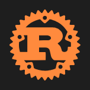

# Svg



Imagem SVG desenhada como vetor. `source` é o arquivo no projeto (`assets/images/logo.svg`); `color` é o `currentColor` (sem ela, a cor de texto do tema: ícones em SVG acompanham o tema claro e o escuro).

**Paleta:** Additional · **controle visual** · também tem as [propriedades e eventos comuns a todo controle](controles.md)

## Propriedades

### Aparência

| Propriedade | No Object Inspector | Tipo | O que faz |
|---|---|---|---|
| `source` | Origem | texto | O arquivo SVG no projeto (`assets/images/logo.svg`). |
| `color` | Cor | cor | A cor do `currentColor` do SVG; sem cor, a cor de texto do tema. |
| `fit` | Ajuste | um de: `contain`, `cover`, `stretch`, `center`, `original` | Como a imagem ocupa o controle: caber inteira, cobrir, esticar... |
| `highlight` | Destacar | texto | Os `id` dos elementos pintados com `highlight_color`, separados por `;`; vazio: nenhum. |
| `highlight_color` | Cor de destaque da área | cor | A cor dos elementos do `highlight`; sem cor, a cor de destaque do tema. |
| `zoom_to` | Aproximar até | texto | O `id` do elemento cuja área é mostrada (o município dentro do mapa); vazio: o SVG inteiro. |

## Em código

No form, o `Svg1` com o evento ligado (no Object Inspector, na aba Eventos):

```json
{ "class": "Svg", "name": "Svg1" }
```

E o handler, um método do form (`self.Svg1` já é um `Svg`):

```rust
impl FrmPrincipal {
    pub fn form_show(&mut self, ui: &mut Ui, _sender: ComponentId, _args: &EventArgs) {
        let atual = self.Svg1.source(ui);
        self.Svg1.set_source(ui, format!("{atual}!"));
    }
}
```

(Sem eventos próprios: o exemplo usa o `on_show` do form.)
