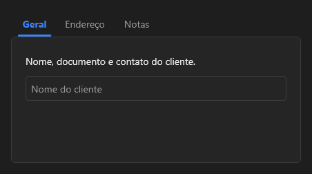

# TabControl



Abas: os filhos são `TabItem`s, cada um uma página; só a de `tab_index` aparece. Clique numa aba (ou Ctrl+Tab com o foco) troca; `on_change` traz o índice. Sem `show_tabs`, só as páginas, sem barra nem moldura (como um `PageControl` com as abas escondidas): a tela tem a própria navegação e troca a página pelo `tab_index`; no designer aparece uma página por vez.

**Paleta:** Layouts · **controle visual** · também tem as [propriedades e eventos comuns a todo controle](controles.md)

## Propriedades

### Aparência

| Propriedade | No Object Inspector | Tipo |
|---|---|---|
| `show_tabs` | Mostra as abas | lógico |

### Comportamento

| Propriedade | No Object Inspector | Tipo |
|---|---|---|
| `tab_index` | Aba escolhida | inteiro |
| `transition` | Transição | um de: `none`, `fade`, `slide_left`, `slide_right`, `slide_up`, `slide_down` |

## Eventos

| Evento | Quando | No Object Inspector | Pergunta |
|---|---|---|---|
| `on_change` | o valor mudou (pelo usuário ou pelo código, como na VCL) | — |  |

## Em código

No form, o `TabControl1` com o evento ligado (no Object Inspector, na aba Eventos):

```json
{ "class": "TabControl", "name": "TabControl1", "on_change": "tab_control1_change" }
```

E o handler, um método do form (`self.TabControl1` já é um `TabControl`):

```rust
impl FrmPrincipal {
    pub fn tab_control1_change(&mut self, ui: &mut Ui, _sender: ComponentId, _args: &EventArgs) {
        let atual = self.TabControl1.tab_index(ui);
        self.TabControl1.set_tab_index(ui, atual + 1);
    }
}
```
