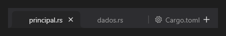

# TabStrip



Faixa de abas como as de um navegador: fechar, acrescentar, arrastar para reordenar e mostrar a página da aba escolhida.

**Paleta:** Layouts · **controle visual** · também tem as [propriedades e eventos comuns a todo controle](controles.md)

## Propriedades

### Aparência

| Propriedade | No Object Inspector | Tipo |
|---|---|---|
| `max_tab_width` | Largura máxima da aba | número |

### Comportamento

| Propriedade | No Object Inspector | Tipo |
|---|---|---|
| `tab_index` | Aba escolhida | inteiro |
| `closable` | Pode fechar | lógico |
| `show_add` | Mostra o "+" | lógico |
| `auto_close` | Fecha sozinho | lógico |
| `tear_off` | Arrancar abas | lógico |
| `drop_group` | Grupo de arrasto | texto |
| `page_host` | Lugar das páginas | componente |
| `close_empty` | Fecha a janela vazia | lógico |

## Eventos

| Evento | Quando | No Object Inspector | Pergunta |
|---|---|---|---|
| `on_change` | o valor mudou (pelo usuário ou pelo código, como na VCL) | — |  |
| `on_close` | o form fechou | — |  |
| `on_add` | — | — |  |
| `on_reorder` | — | — |  |
| `on_tear_off` | — | — |  |
| `on_tab_drop` | — | — |  |
| `on_new_window` | — | — |  |

## Em código

No form, o `TabStrip1` com o evento ligado (no Object Inspector, na aba Eventos):

```json
{ "class": "TabStrip", "name": "TabStrip1", "on_change": "tab_strip1_change" }
```

E o handler, um método do form (`self.TabStrip1` já é um `TabStrip`):

```rust
impl FrmPrincipal {
    pub fn tab_strip1_change(&mut self, ui: &mut Ui, _sender: ComponentId, _args: &EventArgs) {
        let atual = self.TabStrip1.tab_index(ui);
        self.TabStrip1.set_tab_index(ui, atual + 1);
    }
}
```
