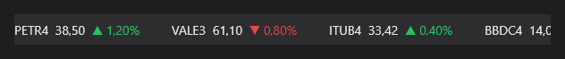

# TickerTape



Faixa de cotações rolando (como no rodapé dos canais de notícias). `items` = `"PETR4:38.50:1.2;VALE3:61.10:-0.8"` (ativo:preço:variação %); `speed` em pontos por segundo; para enquanto o mouse está em cima.

**Paleta:** Trader · **controle visual** · também tem as [propriedades e eventos comuns a todo controle](controles.md)

## Propriedades

### Aparência

| Propriedade | No Object Inspector | Tipo |
|---|---|---|
| `decimals` | Casas decimais | inteiro |

### Comportamento

| Propriedade | No Object Inspector | Tipo |
|---|---|---|
| `speed` | Velocidade | número |

### Dados

| Propriedade | No Object Inspector | Tipo |
|---|---|---|
| `items` | Itens | texto |

## Em código

No form, o `TickerTape1` com o evento ligado (no Object Inspector, na aba Eventos):

```json
{ "class": "TickerTape", "name": "TickerTape1" }
```

E o handler, um método do form (`self.TickerTape1` já é um `TickerTape`):

```rust
impl FrmPrincipal {
    pub fn form_show(&mut self, ui: &mut Ui, _sender: ComponentId, _args: &EventArgs) {
        let atual = self.TickerTape1.items(ui);
        self.TickerTape1.set_items(ui, format!("{atual}!"));
    }
}
```

(Sem eventos próprios: o exemplo usa o `on_show` do form.)
