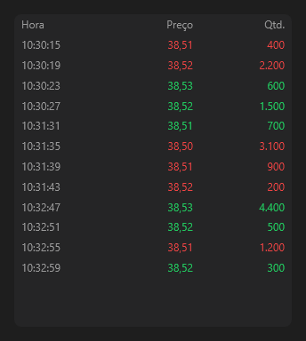

# TimeAndSales



Times & trades: os negócios do mais novo para o mais velho, verde na compra e vermelho na venda, em negrito a partir de `big_size`. `TimeAndSales::add` acrescenta.

**Paleta:** Trader · **controle visual** · também tem as [propriedades e eventos comuns a todo controle](controles.md)

## Propriedades

### Aparência

| Propriedade | No Object Inspector | Tipo |
|---|---|---|
| `big_size` | Volume grande | número |
| `decimals` | Casas decimais | inteiro |

### Comportamento

| Propriedade | No Object Inspector | Tipo |
|---|---|---|
| `max_rows` | Máximo de linhas | inteiro |

## Em código

No form, o `TimeAndSales1` com o evento ligado (no Object Inspector, na aba Eventos):

```json
{ "class": "TimeAndSales", "name": "TimeAndSales1" }
```

E o handler, um método do form (`self.TimeAndSales1` já é um `TimeAndSales`):

```rust
impl FrmPrincipal {
    pub fn form_show(&mut self, ui: &mut Ui, _sender: ComponentId, _args: &EventArgs) {
        let atual = self.TimeAndSales1.max_rows(ui);
        self.TimeAndSales1.set_max_rows(ui, atual + 1);
    }
}
```

(Sem eventos próprios: o exemplo usa o `on_show` do form.)
