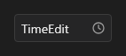

# TimeEdit



Campo de hora: `time` é `14:30` (ou `14:30:15` com `seconds`). ↑/↓ e a roda (com o foco) somam `increment` minutos. `on_change` traz a hora. O botão do relógio (ou F4, Alt+↓) abre o `TimePicker`.

**Paleta:** Additional · **controle visual** · também tem as [propriedades e eventos comuns a todo controle](controles.md)

## Propriedades

### Aparência

| Propriedade | No Object Inspector | Tipo | O que faz |
|---|---|---|---|
| `seconds` | Com segundos | lógico | Mostra e edita também os segundos (`14:30:15`). |
| `placeholder` | Texto de exemplo | texto | Texto apagado mostrado enquanto o campo está vazio. |
| `border` | Borda | lógico | A borda da caixa (desligada: só o texto, sem o contorno nem o traço do foco; dentro de um painel ou numa tabela). Ligada por padrão. |
| `icon` | Ícone | texto | Ícone à esquerda do texto (a lupa da busca); vazio: nenhum. |
| `label` | Rótulo | texto | Rótulo do campo, que sobe para a borda com foco ou com texto; vazio: sem rótulo. |
| `helper` | Texto de ajuda | texto | Texto de ajuda embaixo do campo (o `error` aparece no lugar dele quando há). |
| `counter` | Contador | lógico | Mostra o contador de caracteres embaixo (`3/20` com `max_length`). |
| `prefix` | Prefixo | texto | Texto fixo antes do valor (`R$`), fora do que é editado. |
| `suffix` | Sufixo | texto | Texto fixo depois do valor (`kg`), fora do que é editado. |

### Comportamento

| Propriedade | No Object Inspector | Tipo | O que faz |
|---|---|---|---|
| `increment` | Incremento | inteiro | Minutos somados pelas setas. |
| `max_length` | Tamanho máximo | inteiro | Limite de caracteres; 0 = sem limite. |
| `read_only` | Somente leitura | lógico | Mostra e deixa selecionar e copiar, mas não deixa editar. |
| `password` | Senha (esconde o texto) | lógico | Mostra `•` no lugar dos caracteres e bloqueia copiar/recortar. |
| `sensitive` | Dado pessoal (LGPD: mascarado nas gravações) | lógico | Dado pessoal (LGPD): as gravações do `EventRecorder` mascaram o que é digitado aqui, a não ser com o `record_sensitive` dele ligado. Liga e desliga em tempo de execução. |
| `auto_select` | Selecionar ao entrar | lógico | Ganhar o foco seleciona o texto todo (ligado por padrão). |
| `clear_button` | Botão de limpar | lógico | Um "×" à direita que apaga o texto (só aparece com texto). |
| `mask` | Máscara | texto | Máscara de digitação: `#` dígito, `A` letra, `X` letra ou dígito, o resto entra sozinho (`(##) #####-####`); vazio: livre. |
| `rules` | Regras de validação | texto | Regras conferidas ao sair do campo e por `validate_form`, separadas por `;` (`required;email;min:3;max:20;number;cpf`); vazio: nenhuma. |
| `spellcheck` | Corretor ortográfico | lógico | Sublinha as palavras erradas (o motor de texto da plataforma ou o do app); o clique direito numa delas mostra as correções. |
| `autocomplete` | Completar sozinho | lógico | Completa a palavra enquanto digita: o resto aparece apagado depois do cursor e o Tab (ou a seta para a direita) aceita. |
| `language` | Idioma | texto | Idioma da correção e das sugestões (`"pt-BR"`); vazio: o do sistema. |
| `keyboard_suggestions` | Sugestões do teclado | lógico | Celular: a faixa de sugestões e a correção automática do teclado do sistema (desligue em códigos, logins, identificadores). |

### Cursor

| Propriedade | No Object Inspector | Tipo | O que faz |
|---|---|---|---|
| `caret_color` | Cor do cursor | cor | Cor do cursor; vazio: a cor do texto. |
| `caret_width` | Largura do cursor | número | Largura do cursor (linha) ou altura (sublinhado), em pontos. |
| `caret_style` | Forma do cursor | um de: `line`, `block`, `underline` | Forma do cursor: linha, bloco ou sublinhado. |
| `caret_blink` | Piscar do cursor (ms) | duração (ms) | Intervalo de piscar (ms, o ciclo inteiro); 0: não pisca. |

### Dados

| Propriedade | No Object Inspector | Tipo | O que faz |
|---|---|---|---|
| `time` | Hora | texto | A hora, `14:30` (ou `14:30:15` com `seconds`); vazia = nenhuma. |
| `text` | Texto | texto | O texto do campo (com a `mask`, já formatado). |
| `error` | Erro | texto | Mensagem de erro embaixo do campo, com a borda vermelha; vazio: sem erro. |

### Teclado

| Propriedade | No Object Inspector | Tipo | O que faz |
|---|---|---|---|
| `allowed_chars` | Caracteres permitidos | texto | Os caracteres liberados (vencem um bloqueio do form ou de um painel), os bloqueados e se só os liberados valem (`allowed_chars = "0-9"` com `only_allowed`: só números). Faixas como `a-z`; `-` é o hífen. Vale para o digitado e o colado. |
| `blocked_chars` | Caracteres bloqueados | texto | Os caracteres recusados ao digitar e ao colar (faixas como `a-z`); vazio: nenhum. |
| `only_allowed` | Só os permitidos | lógico | Só os caracteres de `allowed_chars` valem; o resto é recusado. |
| `char_map` | Trocas de caracteres | texto | Trocas do que o teclado produz: pares "digitado, entregue" (`",."` troca a vírgula por ponto), ao digitar e ao colar; vale também o de um contêiner (veja o `Form`). |
| `char_case` | Maiúsculas e minúsculas | um de: `normal`, `upper`, `lower` | Maiúsculas ou minúsculas no valor: ao digitar, ao colar e quando o código grava o `text`. Ligado a um campo, manda o `char_case` do campo. |

### Texto

| Propriedade | No Object Inspector | Tipo | O que faz |
|---|---|---|---|
| `h_align` | Alinhamento horizontal | um de: `leading`, `center`, `trailing`, `justify` | Posição do texto na largura: começo, centro ou fim. |
| `v_align` | Alinhamento vertical | um de: `leading`, `center`, `trailing`, `justify` | Posição do texto na altura: em cima, no meio ou embaixo. |
| `wrap` | Quebra de linha | lógico | Quebra automática de linha (fora da edição). |
| `trimming` | Reticências | um de: `none`, `character`, `word` | Reticências quando o texto não cabe (fora da edição). |

## Eventos

| Evento | Quando | No Object Inspector | Pergunta |
|---|---|---|---|
| `on_change` | o valor mudou (pelo usuário ou pelo código) | — |  |
| `on_caret_move` | — | — |  |
| `on_paste` | — | — |  |

## Em código

No form, o `TimeEdit1` com o evento ligado (no Object Inspector, na aba Eventos):

```json
{ "class": "TimeEdit", "name": "TimeEdit1", "on_change": "time_edit1_change" }
```

E o handler, um método do form (`self.TimeEdit1` já é um `TimeEdit`):

```rust
impl FrmPrincipal {
    pub fn time_edit1_change(&mut self, ui: &mut Ui, _sender: ComponentId, _args: &EventArgs) {
        let atual = self.TimeEdit1.time(ui);
        self.TimeEdit1.set_time(ui, format!("{atual}!"));
    }
}
```
