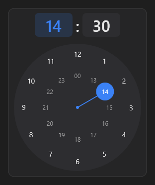

# TimePicker



Seletor de hora com relógio. `time` é `14:30`; `on_change` a cada mudança.

**Paleta:** Additional · **controle visual** · também tem as [propriedades e eventos comuns a todo controle](controles.md)

## Propriedades

### Comportamento

| Propriedade | No Object Inspector | Tipo | O que faz |
|---|---|---|---|
| `minutes_mode` | Escolhendo os minutos | lógico | Mostrando os minutos (senão, as horas). |

### Dados

| Propriedade | No Object Inspector | Tipo | O que faz |
|---|---|---|---|
| `time` | Hora | texto |  |

## Eventos

| Evento | Quando | No Object Inspector | Pergunta |
|---|---|---|---|
| `on_change` | o valor mudou (pelo usuário ou pelo código, como na VCL) | — |  |

## Em código

No form, o `TimePicker1` com o evento ligado (no Object Inspector, na aba Eventos):

```json
{ "class": "TimePicker", "name": "TimePicker1", "on_change": "time_picker1_change" }
```

E o handler, um método do form (`self.TimePicker1` já é um `TimePicker`):

```rust
impl FrmPrincipal {
    pub fn time_picker1_change(&mut self, ui: &mut Ui, _sender: ComponentId, _args: &EventArgs) {
        let atual = self.TimePicker1.time(ui);
        self.TimePicker1.set_time(ui, format!("{atual}!"));
    }
}
```
