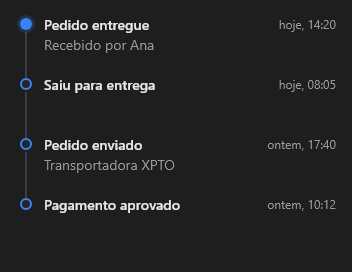

# Timeline



Linha do tempo (o `v-timeline`): `items` separados por `;`, cada um `título|quando|texto` (as partes depois do título são opcionais). Pontos na cor da variante; o primeiro em destaque.

**Paleta:** Additional · **controle visual** · também tem as [propriedades e eventos comuns a todo controle](controles.md)

## Propriedades

### Aparência

| Propriedade | No Object Inspector | Tipo | O que faz |
|---|---|---|---|
| `item_height` | Altura do item | número |  |

### Dados

| Propriedade | No Object Inspector | Tipo | O que faz |
|---|---|---|---|
| `items` | Itens | texto |  |

## Em código

No form, o `Timeline1` com o evento ligado (no Object Inspector, na aba Eventos):

```json
{ "class": "Timeline", "name": "Timeline1" }
```

E o handler, um método do form (`self.Timeline1` já é um `Timeline`):

```rust
impl FrmPrincipal {
    pub fn form_show(&mut self, ui: &mut Ui, _sender: ComponentId, _args: &EventArgs) {
        let atual = self.Timeline1.items(ui);
        self.Timeline1.set_items(ui, format!("{atual}!"));
    }
}
```

(Sem eventos próprios: o exemplo usa o `on_show` do form.)
