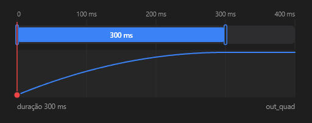

# TimingEditor



Linha do tempo de uma animação (o painel Animations do DevTools): o atraso (tracejado), a duração (a barra), a volta (`auto_reverse`) e as repetições (`looping`), com a curva do valor ao longo do tempo. Arraste o começo para mudar o atraso, o fim para mudar a duração ou a barra para mover tudo. Os tempos andam de `snap` em `snap` ms (Shift: 1 ms). Com `playing`, uma agulha percorre a linha do tempo.

**Paleta:** Additional · **controle visual** · também tem as [propriedades e eventos comuns a todo controle](controles.md)

## Propriedades

### Animação

| Propriedade | No Object Inspector | Tipo | O que faz |
|---|---|---|---|
| `delay` | Atraso | duração (ms) | O atraso antes de a animação começar, em ms (o tracejado). |
| `duration` | Duração | duração (ms) | A duração da animação, em ms (a barra). |
| `easing` | Curva de aceleração | curva de suavização | A curva de suavização desenhada sobre a barra. |
| `auto_reverse` | Volta sozinho | lógico | A animação volta ao valor de partida depois de chegar ao fim. |
| `looping` | Repetindo | lógico | A animação se repete sem parar. |

### Comportamento

| Propriedade | No Object Inspector | Tipo | O que faz |
|---|---|---|---|
| `snap` | Passo com Shift | número | O passo dos tempos ao arrastar, em ms (com Shift: 1 ms). |
| `playing` | Tocando | lógico | Uma agulha percorre a linha do tempo, como a animação tocando. |

## Eventos

| Evento | Quando | No Object Inspector | Pergunta |
|---|---|---|---|
| `on_change` | o valor mudou (pelo usuário ou pelo código) | — |  |
| `on_commit` | — | — |  |

## Em código

No form, o `TimingEditor1` com o evento ligado (no Object Inspector, na aba Eventos):

```json
{ "class": "TimingEditor", "name": "TimingEditor1", "on_change": "timing_editor1_change" }
```

E o handler, um método do form (`self.TimingEditor1` já é um `TimingEditor`):

```rust
impl FrmPrincipal {
    pub fn timing_editor1_change(&mut self, ui: &mut Ui, _sender: ComponentId, _args: &EventArgs) {
        let atual = self.TimingEditor1.auto_reverse(ui);
        self.TimingEditor1.set_auto_reverse(ui, !atual);
    }
}
```
