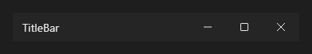

# TitleBar



Barra de título própria da janela, desenhada pelo Aylis: o título, os botões de minimizar, maximizar e fechar e espaço para os seus controles. Com `border_style = custom` no form; no Windows 11, o mouse parado no maximizar abre o menu de layouts do sistema (Snap), e os cantos da janela vêm do sistema (`window_corners` do form).

**Paleta:** Additional · **controle visual** · também tem as [propriedades e eventos comuns a todo controle](controles.md)

## Propriedades

### Aparência

| Propriedade | No Object Inspector | Tipo | O que faz |
|---|---|---|---|
| `caption` | Título | texto | Vazio: o `caption` do form. |
| `show_minimize` | Mostra o minimizar | lógico | Mostra o botão minimizar. |
| `show_maximize` | Mostra o maximizar | lógico | Mostra o botão maximizar/restaurar. |
| `show_close` | Mostra o fechar | lógico | Mostra o botão fechar. |

## Em código

No form, o `TitleBar1` com o evento ligado (no Object Inspector, na aba Eventos):

```json
{ "class": "TitleBar", "name": "TitleBar1" }
```

E o handler, um método do form (`self.TitleBar1` já é um `TitleBar`):

```rust
impl FrmPrincipal {
    pub fn form_show(&mut self, ui: &mut Ui, _sender: ComponentId, _args: &EventArgs) {
        let atual = self.TitleBar1.caption(ui);
        self.TitleBar1.set_caption(ui, format!("{atual}!"));
    }
}
```

(Sem eventos próprios: o exemplo usa o `on_show` do form.)
