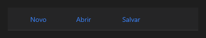

# ToolBar



Barra de ferramentas no topo: os botões dentro ficam lado a lado (use `align: left`).

**Paleta:** Layouts · **controle visual** · também tem as [propriedades e eventos comuns a todo controle](controles.md)

## Propriedades

Só as comuns.

## Em código

No form, o `ToolBar1` com o evento ligado (no Object Inspector, na aba Eventos):

```json
{ "class": "ToolBar", "name": "ToolBar1" }
```

E o handler, um método do form (`self.ToolBar1` já é um `ToolBar`):

```rust
impl FrmPrincipal {
    pub fn form_show(&mut self, ui: &mut Ui, _sender: ComponentId, _args: &EventArgs) {
        let _ = &self.ToolBar1;
    }
}
```

(Sem eventos próprios: o exemplo usa o `on_show` do form.)
