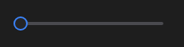

# TrackBar



Controle deslizante: arraste o polegar, clique no trilho, use as setas, Home/End e PageUp/PageDown. `on_change` traz o valor (também durante o arrasto).

**Paleta:** Standard · **controle visual** · também tem as [propriedades e eventos comuns a todo controle](controles.md)

## Propriedades

### Aparência

| Propriedade | No Object Inspector | Tipo | O que faz |
|---|---|---|---|
| `vertical` | Vertical | lógico | Vertical em vez de horizontal. |
| `thumb_size` | Tamanho do botão | número | Diâmetro do polegar (0 = o do visual do tema). |
| `track_size` | Espessura do trilho | número | Espessura do trilho (0 = a do visual do tema). |
| `solid_thumb` | Botão cheio | lógico | Polegar cheio na cor de destaque, sem anel (o `input[type=range]` das páginas web). |

### Comportamento

| Propriedade | No Object Inspector | Tipo | O que faz |
|---|---|---|---|
| `min` | Mínimo | número | O valor da ponta esquerda (ou de baixo, na vertical). |
| `max` | Máximo | número | O valor da ponta direita (ou de cima, na vertical). |
| `frequency` | Frequência das marcas | número | Passo (0 = contínuo). |
| `limit` | Limite | número | Daqui para cima o trilho preenchido e o polegar ficam na cor de perigo, com uma marca fina no ponto (o volume acima de 100 %: amplificando). 0 = sem limite. |

### Dados

| Propriedade | No Object Inspector | Tipo | O que faz |
|---|---|---|---|
| `value` | Valor | número | O valor, a posição do polegar entre `min` e `max`. |

## Eventos

| Evento | Quando | No Object Inspector | Pergunta |
|---|---|---|---|
| `on_change` | o valor mudou (pelo usuário ou pelo código) | — |  |

## Em código

No form, o `TrackBar1` com o evento ligado (no Object Inspector, na aba Eventos):

```json
{ "class": "TrackBar", "name": "TrackBar1", "on_change": "track_bar1_change" }
```

E o handler, um método do form (`self.TrackBar1` já é um `TrackBar`):

```rust
impl FrmPrincipal {
    pub fn track_bar1_change(&mut self, ui: &mut Ui, _sender: ComponentId, _args: &EventArgs) {
        let atual = self.TrackBar1.value(ui);
        self.TrackBar1.set_value(ui, atual + 10.0);
    }
}
```
