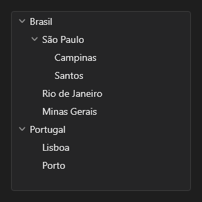

# TreeView



Árvore, virtualizada: só as linhas visíveis são pintadas.

**Paleta:** Additional · **controle visual** · também tem as [propriedades e eventos comuns a todo controle](controles.md)

## Propriedades

### Aparência

| Propriedade | No Object Inspector | Tipo | O que faz |
|---|---|---|---|
| `item_height` | Altura do item | número | Altura de cada linha, em pontos. |

### Comportamento

| Propriedade | No Object Inspector | Tipo | O que faz |
|---|---|---|---|
| `overscroll` | Fim da rolagem | um de: `auto`, `glow`, `stretch`, `bounce`, `none` | O efeito de fim da rolagem no toque (`auto`: o do sistema; veja `aylis_core::overscroll`). |

### Dados

| Propriedade | No Object Inspector | Tipo | O que faz |
|---|---|---|---|
| `items` | Itens | texto | Os nós, separados por `;`, com um `>` na frente por nível (`Brasil;>São Paulo;>>Campinas;Portugal`). |

## Eventos

| Evento | Quando | No Object Inspector | Pergunta |
|---|---|---|---|
| `on_change` | o valor mudou (pelo usuário ou pelo código) | — |  |
| `on_expand` | — | — |  |
| `on_collapse` | — | — |  |

## Em código

No form, o `TreeView1` com o evento ligado (no Object Inspector, na aba Eventos):

```json
{ "class": "TreeView", "name": "TreeView1", "on_change": "tree_view1_change" }
```

E o handler, um método do form (`self.TreeView1` já é um `TreeView`):

```rust
impl FrmPrincipal {
    pub fn tree_view1_change(&mut self, ui: &mut Ui, _sender: ComponentId, _args: &EventArgs) {
        let atual = self.TreeView1.items(ui);
        self.TreeView1.set_items(ui, format!("{atual}!"));
    }
}
```
