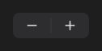

# UpDown



Os botões − e + (o "stepper" do iOS): `value` entre `min` e `max`, de `step` em `step`; segurar repete. `on_change` com o valor.

**Paleta:** Standard · **controle visual** · também tem as [propriedades e eventos comuns a todo controle](controles.md)

## Propriedades

### Dados

| Propriedade | No Object Inspector | Tipo | O que faz |
|---|---|---|---|
| `value` | Valor | número | O valor atual, entre `min` e `max`. |
| `min` | Mínimo | número | O menor valor: nele o − fica apagado. |
| `max` | Máximo | número | O maior valor: nele o + fica apagado. |
| `step` | Passo | número | Quanto cada toque no − ou no + soma ou tira. |

## Eventos

| Evento | Quando | No Object Inspector | Pergunta |
|---|---|---|---|
| `on_change` | o valor mudou (pelo usuário ou pelo código) | — |  |

## Em código

No form, o `UpDown1` com o evento ligado (no Object Inspector, na aba Eventos):

```json
{ "class": "UpDown", "name": "UpDown1", "on_change": "up_down1_change" }
```

E o handler, um método do form (`self.UpDown1` já é um `UpDown`):

```rust
impl FrmPrincipal {
    pub fn up_down1_change(&mut self, ui: &mut Ui, _sender: ComponentId, _args: &EventArgs) {
        let atual = self.UpDown1.value(ui);
        self.UpDown1.set_value(ui, atual + 10.0);
    }
}
```
