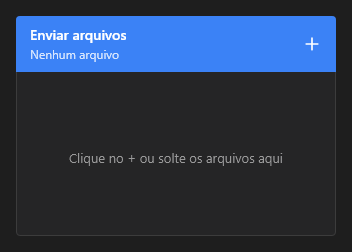

# Uploader



O envio de arquivos (`QUploader`): o cabeçalho com o título, o "+" (escolher, ou soltar arquivos em cima) e o "enviar"; embaixo, os arquivos com o tamanho e a barra de progresso. O envio é do app: `on_upload` traz os arquivos (`;`) e o app vai pondo o andamento em `progress` (uma fração de 0 a 1 por arquivo, `0.5;1`).

**Paleta:** Quasar · **controle visual** · também tem as [propriedades e eventos comuns a todo controle](controles.md)

## Propriedades

### Aparência

| Propriedade | No Object Inspector | Tipo | O que faz |
|---|---|---|---|
| `title` | Título | texto | O título do cabeçalho. |

### Comportamento

| Propriedade | No Object Inspector | Tipo | O que faz |
|---|---|---|---|
| `filter` | Filtro | texto | Os tipos aceitos no "+", como no diálogo de abrir (`Imagens\|*.png;*.jpg`); vazio: todos. |
| `multiple` | Vários | lógico | Deixa escolher vários arquivos de uma vez. |
| `auto_upload` | Envia sozinho | lógico | Envia assim que os arquivos são escolhidos. |

### Dados

| Propriedade | No Object Inspector | Tipo | O que faz |
|---|---|---|---|
| `files` | Arquivos | texto | Os caminhos dos arquivos escolhidos, separados por `;` (vazio: nenhum). |
| `progress` | Progresso | texto | O andamento de cada arquivo, de 0 a 1, separados por `;` na ordem dos `files` (`0.5;1`). |

## Eventos

| Evento | Quando | No Object Inspector | Pergunta |
|---|---|---|---|
| `on_change` | o valor mudou (pelo usuário ou pelo código) | — |  |
| `on_upload` | — | — |  |

## Em código

No form, o `Uploader1` com o evento ligado (no Object Inspector, na aba Eventos):

```json
{ "class": "Uploader", "name": "Uploader1", "on_change": "uploader1_change" }
```

E o handler, um método do form (`self.Uploader1` já é um `Uploader`):

```rust
impl FrmPrincipal {
    pub fn uploader1_change(&mut self, ui: &mut Ui, _sender: ComponentId, _args: &EventArgs) {
        let atual = self.Uploader1.title(ui);
        self.Uploader1.set_title(ui, format!("{atual}!"));
    }
}
```
