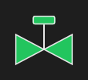

# Valve



Válvula (gaveta): os dois triângulos e o atuador; verde aberta, cinza fechada, amarela em trânsito. Clicar dispara `on_click` (quem abre é o app).

**Paleta:** Industrial · **controle visual** · também tem as [propriedades e eventos comuns a todo controle](controles.md)

## Propriedades

### Dados

| Propriedade | No Object Inspector | Tipo | O que faz |
|---|---|---|---|
| `state` | Estado | um de: `open`, `closed`, `transit` | Aberta (verde), fechada (cinza) ou em trânsito (amarela). |
| `alarm` | Alarme | lógico | Em alarme: a válvula fica vermelha e o contorno pisca. |

## Em código

No form, o `Valve1` com o evento ligado (no Object Inspector, na aba Eventos):

```json
{ "class": "Valve", "name": "Valve1" }
```

E o handler, um método do form (`self.Valve1` já é um `Valve`):

```rust
impl FrmPrincipal {
    pub fn form_show(&mut self, ui: &mut Ui, _sender: ComponentId, _args: &EventArgs) {
        let atual = self.Valve1.alarm(ui);
        self.Valve1.set_alarm(ui, !atual);
    }
}
```

(Sem eventos próprios: o exemplo usa o `on_show` do form.)
