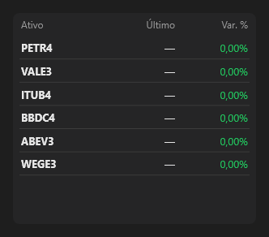

# Watchlist



Lista de ativos: ativo, último preço e variação; a célula pisca verde na alta e vermelha na baixa a cada `Watchlist::update`. Clique: `on_select` com o ativo.

**Paleta:** Trader · **controle visual** · também tem as [propriedades e eventos comuns a todo controle](controles.md)

## Propriedades

### Aparência

| Propriedade | No Object Inspector | Tipo | O que faz |
|---|---|---|---|
| `decimals` | Casas decimais | inteiro |  |

### Dados

| Propriedade | No Object Inspector | Tipo | O que faz |
|---|---|---|---|
| `symbols` | Símbolos | texto | `"PETR4;VALE3;ITUB4"` (os preços chegam por `update`). |

## Eventos

| Evento | Quando | No Object Inspector | Pergunta |
|---|---|---|---|
| `on_select` | — | — |  |

## Em código

No form, o `Watchlist1` com o evento ligado (no Object Inspector, na aba Eventos):

```json
{ "class": "Watchlist", "name": "Watchlist1", "on_select": "watchlist1_select" }
```

E o handler, um método do form (`self.Watchlist1` já é um `Watchlist`):

```rust
impl FrmPrincipal {
    pub fn watchlist1_select(&mut self, ui: &mut Ui, _sender: ComponentId, _args: &EventArgs) {
        let atual = self.Watchlist1.symbols(ui);
        self.Watchlist1.set_symbols(ui, format!("{atual}!"));
    }
}
```
