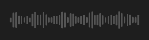

# Waveform



Onda de um áudio (mensagem de voz, gravação): barras com a intensidade de cada trecho, a parte já tocada em destaque. Clicar ou arrastar busca (`on_seek`, em segundos).

**Paleta:** Media · **controle visual** · também tem as [propriedades e eventos comuns a todo controle](controles.md)

## Propriedades

### Aparência

| Propriedade | No Object Inspector | Tipo |
|---|---|---|
| `seek_bar` | Barra de posição | lógico |
| `paused` | Pausado | lógico |

### Dados

| Propriedade | No Object Inspector | Tipo |
|---|---|---|
| `position` | Posição | número |
| `duration` | Duração | número |

## Eventos

| Evento | Quando | No Object Inspector | Pergunta |
|---|---|---|---|
| `on_seek` | — | — |  |

## Em código

No form, o `Waveform1` com o evento ligado (no Object Inspector, na aba Eventos):

```json
{ "class": "Waveform", "name": "Waveform1", "on_seek": "waveform1_seek" }
```

E o handler, um método do form (`self.Waveform1` já é um `Waveform`):

```rust
impl FrmPrincipal {
    pub fn waveform1_seek(&mut self, ui: &mut Ui, _sender: ComponentId, _args: &EventArgs) {
        let atual = self.Waveform1.position(ui);
        self.Waveform1.set_position(ui, atual + 10.0);
    }
}
```
