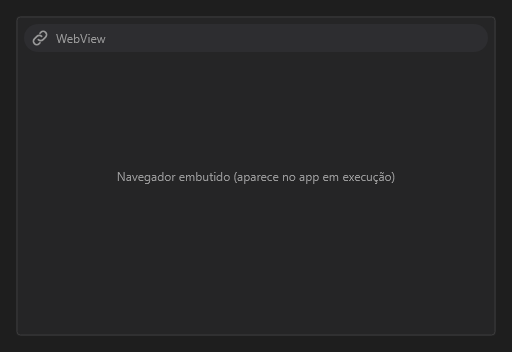

# WebView



Navegador embutido. `url` abre um endereço; sem ele, `html` mostra o texto dado.

**Paleta:** Additional · **controle visual** · também tem as [propriedades e eventos comuns a todo controle](controles.md)

## Propriedades

### Aparência

| Propriedade | No Object Inspector | Tipo |
|---|---|---|
| `skeleton` | Skeleton ao carregar | lógico |

### Comportamento

| Propriedade | No Object Inspector | Tipo |
|---|---|---|
| `allowed_origins` | Origens permitidas | texto |
| `allowed_navigation` | Navegação permitida | texto |
| `sandbox` | Restrições do iframe (sandbox) | texto |

### Dados

| Propriedade | No Object Inspector | Tipo |
|---|---|---|
| `url` | Endereço (URL) | texto |
| `html` | Conteúdo (HTML) | texto |

## Eventos

| Evento | Quando | No Object Inspector | Pergunta |
|---|---|---|---|
| `on_load` | — | — |  |
| `on_navigate` | — | — |  |
| `on_blocked` | — | — |  |
| `on_message` | — | — |  |

## Em código

No form, o `WebView1` com o evento ligado (no Object Inspector, na aba Eventos):

```json
{ "class": "WebView", "name": "WebView1", "on_load": "web_view1_load" }
```

E o handler, um método do form (`self.WebView1` já é um `WebView`):

```rust
impl FrmPrincipal {
    pub fn web_view1_load(&mut self, ui: &mut Ui, _sender: ComponentId, _args: &EventArgs) {
        let atual = self.WebView1.url(ui);
        self.WebView1.set_url(ui, format!("{atual}!"));
    }
}
```
