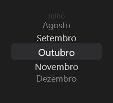

# WheelPicker



A roda de opções do iOS (o `UIPickerView`): arrastar ou rolar gira a roda; ao parar, a opção do meio fica escolhida (`item_index`, `on_change` com o texto). As de longe ficam menores e mais apagadas, como num cilindro.

**Paleta:** Additional · **controle visual** · também tem as [propriedades e eventos comuns a todo controle](controles.md)

## Propriedades

### Aparência

| Propriedade | No Object Inspector | Tipo | O que faz |
|---|---|---|---|
| `row_height` | Altura da linha | número | A altura de cada linha da roda, em pontos. |

### Dados

| Propriedade | No Object Inspector | Tipo | O que faz |
|---|---|---|---|
| `items` | Itens | texto | As opções da roda, separadas por `;`. |
| `item_index` | Item escolhido | inteiro | A opção escolhida, a do meio da roda (0 = a primeira). |

## Eventos

| Evento | Quando | No Object Inspector | Pergunta |
|---|---|---|---|
| `on_change` | o valor mudou (pelo usuário ou pelo código) | — |  |

## Em código

No form, o `WheelPicker1` com o evento ligado (no Object Inspector, na aba Eventos):

```json
{ "class": "WheelPicker", "name": "WheelPicker1", "on_change": "wheel_picker1_change" }
```

E o handler, um método do form (`self.WheelPicker1` já é um `WheelPicker`):

```rust
impl FrmPrincipal {
    pub fn wheel_picker1_change(&mut self, ui: &mut Ui, _sender: ComponentId, _args: &EventArgs) {
        let atual = self.WheelPicker1.items(ui);
        self.WheelPicker1.set_items(ui, format!("{atual}!"));
    }
}
```
