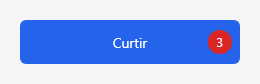
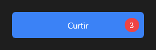

# Seu primeiro componente

Um botão que conta os cliques e mostra o número num selo. Em vez de começar do zero, ele
"herda" do `Button`: o texto, o estilo do tema, o hover, o foco e o `on_click` vêm do botão, e
você escreve só o que é novo.



Componentes são escritos em Rust e vão para a paleta da IDE num pacote; quem usa o pacote
pode programar o app em qualquer linguagem.

## 1. Crie o pacote

Um pacote de componente é um crate Rust com um `package.json` ao lado. Crie a pasta
`BotaoContador` com estes dois arquivos. O `Cargo.toml`:

```toml
# O pacote de código do tutorial "Seu primeiro componente" (docs/tutorial-componente.md): um
# botão que conta os cliques, feito a partir do `Button`. Vai num .aylispkg com
# `aylis-tool pack-code` (veja o tutorial).
[package]
name = "counter-button-aylis"
version = "1.0.0"
edition = "2024"
license = "MIT"
publish = false

[dependencies]
aylis-core = { path = "../../../crates/aylis-core" }
aylis-controls = { path = "../../../crates/aylis-controls" }
```

E o `package.json`:

```json
{
  "name": "BotaoContador",
  "version": "1.0.0",
  "author": "aylis",
  "description": "Botão que conta os cliques e mostra o número num selo (o pacote do tutorial de componente).",
  "category": "Standard",
  "kind": "code",
  "crate": "counter-button-aylis",
  "component": "CounterButton",
  "properties": [
    { "name": "texto", "type": "text", "target": "text", "default": "Curtir" },
    { "name": "contagem", "type": "number", "target": "count", "default": 0 }
  ],
  "events": [{ "name": "on_click", "target": "on_click" }]
}
```

O `package.json` diz à IDE o nome do pacote, a classe (`CounterButton`), em que aba da paleta
ela aparece e as propriedades que o Object Inspector mostra.

## 2. Escreva o componente

O `src/lib.rs` inteiro:

```rust
//! O componente do tutorial "Seu primeiro componente": um botão que conta os cliques e mostra
//! o número num selo. Ele "herda" do `Button`: guarda um botão e o devolve em `inner`, então
//! o texto, o estilo, o hover, o foco e o `on_click` vêm dele; aqui só entra o que é novo.

use aylis_controls::Button;
use aylis_core::{Brush, Canvas, Component, EventCtx, PaintCtx, RectF, TextAlign, Ui, properties};

/// Um botão que conta quantas vezes foi clicado (pelo mouse ou pelo teclado).
pub struct CounterButton {
    /// O botão de base: o que não for sobrescrito aqui vai para ele.
    pub button: Button,
    /// Quantos cliques até agora.
    pub count: i64,
}

impl Default for CounterButton {
    fn default() -> Self {
        Self { button: Button::new("Curtir"), count: 0 }
    }
}

impl Component for CounterButton {
    fn class_name(&self) -> &'static str {
        "CounterButton"
    }

    // A "herança": o resto (propriedades, eventos, estilo) é do botão.
    fn inner(&self) -> Option<&dyn Component> {
        Some(&self.button)
    }

    fn inner_mut(&mut self) -> Option<&mut dyn Component> {
        Some(&mut self.button)
    }

    // Só a propriedade nova; `text` e as outras são do botão.
    properties! {
        count: i64 => "Behavior"
    }

    /// O clique conta e depois chama o do botão (o `inherited`), que dispara o `on_click`.
    fn click(&mut self, ctx: &mut EventCtx<'_>) {
        self.count += 1;
        ctx.repaint();
        self.button.click(ctx);
    }

    /// O botão desenha a si mesmo; por cima, o selo com o número.
    fn paint(&self, canvas: &mut dyn Canvas, ctx: &PaintCtx<'_>) {
        self.button.paint(canvas, ctx);
        let r = ctx.rect;
        let size = (r.height * 0.55).max(18.0);
        let badge = RectF::new(r.right() - size - 8.0, r.y + (r.height - size) / 2.0, size, size);
        canvas.fill_ellipse(badge, &Brush::Solid(ctx.theme.color("danger")));
        let mut text = ctx.text_style();
        text.h_align = TextAlign::Center;
        text.v_align = TextAlign::Center;
        text.color = aylis_core::Color::WHITE;
        text.font.size = size * 0.55;
        canvas.draw_text(&self.count.to_string(), badge, &text);
    }
}

/// Registra a classe na paleta (o código gerado do projeto que usa o pacote chama).
pub fn register(ui: &mut Ui) {
    ui.register_class::<CounterButton>("Standard");
}
```

O que importa nele:

- **`inner` e `inner_mut`** devolvem o botão guardado: tudo o que você não sobrescreve vai
  para ele. É a "herança".
- **`properties!`** declara só a propriedade nova, `count`; `text` e as outras já são do
  botão.
- **`click`** conta e depois chama `self.button.click(ctx)`, o `inherited`: sem essa linha,
  o `on_click` de quem usa o botão deixaria de disparar. O `click` vale para o mouse e para o
  teclado (Enter e espaço com o foco no botão).
- **`paint`** deixa o botão se desenhar e põe o selo por cima.

## 3. Teste

O teste no fim do arquivo clica três vezes e confere a contagem, o `on_click` e o texto
herdado do botão:

```bash
cargo test -p counter-button-aylis
```

## 4. Empacote e use na IDE

```bash
aylis-tool pack-code examples/pacotes/BotaoContador --name BotaoContador --component CounterButton --out BotaoContador.aylispkg
```

Na IDE, **Ferramentas → Pacotes de componentes → Instalar pacote…** e escolha o
`BotaoContador.aylispkg`. O `CounterButton` aparece na aba **Standard** da paleta: arraste para
um form, mude o `text` no Object Inspector e ligue o `on_click` como num botão comum.



O pacote pronto está no repositório, em `examples/pacotes/BotaoContador`.

## Próximos passos

- [Manual: criar um componente](criar-componente.md): os outros jeitos (um subtipo só de
  estilo, a pintura por instância, um componente do zero, com filhos ou não visual).
- [Seu primeiro projeto](tutorial-primeiro-projeto.md), se ainda não fez.
